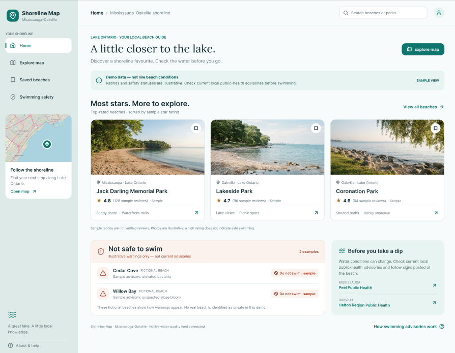
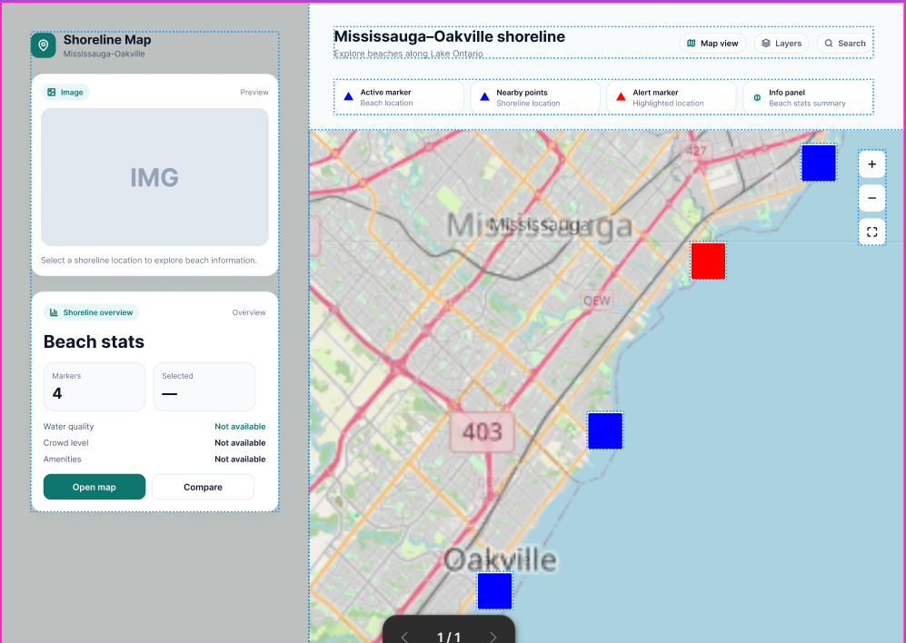
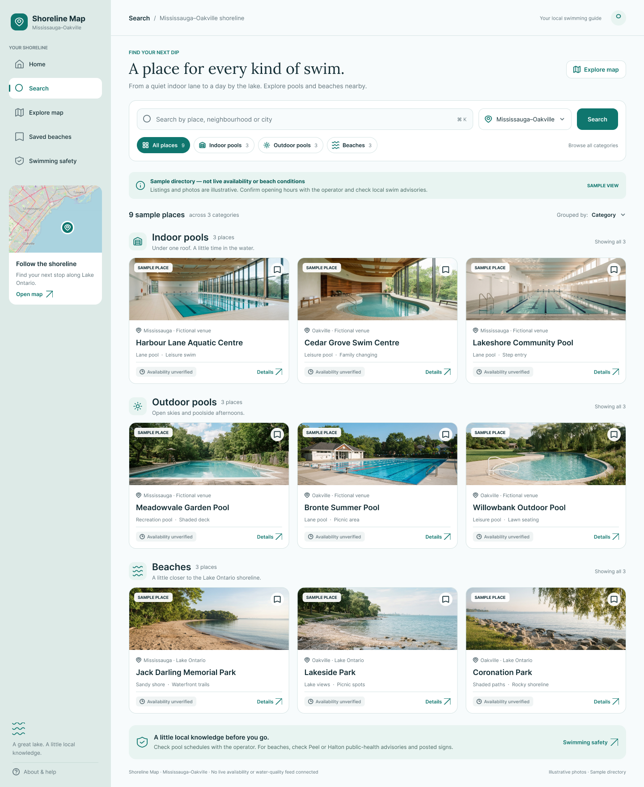

# CanISwim.TO — Project Proposal

**Course:** CSCI 3230U — Web Development  
**Project:** CanISwim.TO
**Repository:** https://github.com/CreamCheesePeanutButter/CanISwim.TO

---

## 1. Project Overview

### 1.1 Application Description

A web app that helps people find out when and where it is safe to swim in Toronto by providing water quality, air quality, temperature, weather, and swimming location information. It also features a community event space where users can host, discover, and promote events, making swimming safer, smarter, and more social.

---

## 2. Data Sources & APIs

CanISwim.TO will use three external APIs: Swimsafe, Toronto Beaches Water Quality, Toronto Beaches Observations.

### 2.1 Toronto Beaches Water Quality

**Documentation:** [Toronto Beaches Water Quality]()

**Purpose:**  
To get beaches geographic map.

**Sample Data Usage:**

Example of get 1 record

```
GET https://ckan0.cf.opendata.inter.prod-toronto.ca/api/3/action/datastore_search?resource_id=8102bd4c-83cd-4354-9788-eecc0c7a09b4&limit=1
```

**Sample JSON Response (Illustrative):**

```json
{
  "records": [
    {
      "_id": 1,
      "beachId": 1,
      "beachName": "Marie Curtis Park East Beach",
      "siteName": "29W",
      "collectionDate": "2026-09-16",
      "eColi": null,
      "geometry": "{\"type\": \"Point\", \"coordinates\": [-79.539696, 43.58592]}"
    }
  ]
}
```

**Fields Used:**

`\_id`: Unique identifier for each record in the Open Data database.

`beachId`: Unique identifier assigned to each beach.

`beachName`: Name of the beach where the water sample was collected.

`siteName`: Name of the specific sampling location at the beach.

`collectionDate`: Date when the water sample was collected.

`eColi`: Measured concentration of E. coli bacteria in the water.

### 2.2 SwimSafe

**Documentation:** [SwimSafe](https://open.toronto.ca/dataset/swimsafe/)

**Purpose:**  
The SwimSafe dataset provides public access to inspection records for Toronto’s public swimming pools, wading pools, hot tubs, and splash pads to help residents assess water safety and compliance with public health regulations.

**Sample Data Usage:**

```http
GET https://ckan0.cf.opendata.inter.prod-toronto.ca/api/3/action/datastore_search?id=1&limit=1
```

**Sample JSON Response (Illustrative):**

```json
{
  "type": "Feature",
  "properties": {
    "_id": 1,
    "unique_id": "0543c99e46f9846674f4e7767d2c0903",
    "facilityName": "YORK RECREATION CENTRE",
    "address": "115 BLACK CREEK DR",
    "estName": "YORK RECREATION CENTRE LANE POOL",
    "type": "Indoor Pool",
    "insStatus": "Pass",
    "insDate": "2026-06-04",
    "observation": "No infractions were observed under the SwimSafe Regulation during an inspection.",
    "infCategory": "None",
    "defDesc": "None",
    "infType": "None",
    "actionDesc": "None"
  },
  "geometry": {
    "type": "MultiPoint",
    "coordinates": [[-79.48129, 43.68614]]
  }
}
```

**Fields Used:**

- \_id: Unique row identifier for Open Data database

- unique_id :
  Unique id for this record connected to source data

- facilityName: Name of a facility. A facility contains one or many establishments

- address:
  Address of facility

- estName:
  Establishment Name; an establishment is a specific pool, spa, etc

- type:
  Category of establishment

- insStatus:
  Status of the inspection (ex: Pass)

- insDate:
  Date of inspection

- observation :
  Observation made during inspection

- infCategory :
  Category of infraction

- defDesc :
  Description of one detail of an infraction

- infType :
  Category of detail of infraction

- actionDesc :
  Action taken based on infraction

- geometry

**Planned Categories:**

- Type: indoor/outdoor
- insStatus: Pass/NotPass
- infType: Category of detail of infraction

### 2.3

**Documentation:** [Toronto Beaches Observations](https://open.toronto.ca/dataset/swimsafe/)

**Purpose:**  
Observations made daily by city staff on Toronto's beaches. Where appropriate, instrumentation such as thermometer or turbidity meters is used to obtain this data. Other observations such as "number of fowl" and "wave action" are estimated.

**Sample Data Usage:**

```http
GET https://ckan0.cf.opendata.inter.prod-toronto.ca/api/3/action/package_show?id=c8ce3e2f-935d-4ef6-ade2-27e08df239f2
```

**Sample JSON Response (Illustrative):**

```json
{
  "_id": 1,
  "dataCollectionDate": "2010-07-23",
  "beachName": "Ward's Island Beach",
  "windSpeed": null,
  "windDirection": "None",
  "airTemp": 20,
  "rain": "Yes",
  "rainAmount": 36,
  "waterTemp": 19.3,
  "waterFowl": 9,
  "waveAction": "MOD",
  "waterClarity": "clear",
  "turbidity": 1
}
```

**Fields Used:**

- `_id`: Unique row identifier for the Open Data database.
- `dataCollectionDate`: Date when observations were collected.
- `beachName`: Name of the beach where observations were collected.
- `windSpeed`: Wind speed measured in kilometres per hour (km/h).
- `windDirection`: Direction of the wind, such as East, North-East, North, North-West, West, South-West, South, or South-East.
- `airTemp`: Air temperature measured in degrees Celsius (°C).
- `rain`: Indicates whether rain was present (Yes or No).
- `rainAmount`: Amount of rainfall in the previous 24 hours, measured in millimetres (mm).
- `waterTemp`: Water temperature measured in degrees Celsius (°C).
- `waterFowl`: Number of waterfowl observed.
- `waveAction`: Observed wave activity, categorized as high, low, moderate, or none.
- `waterClarity`: Text description of the water's visual clarity.
- `turbidity`: Measure of water cloudiness, expressed in Nephelometric Turbidity Units (NTU).

**Planned Categories:**

- Good/bad water temperature
- Good/bad air temperature
- Is rain or not

## 3. Comparable Applications

Below is a comparative analysis of **CanISwim.TO** against existing platforms in the social, booking, and aquatic information spaces:

| Feature                      | Meetup                                                     | Swimply                                         | Swim Guide                                 | CanISwim.TO (Proposed)                                               |
| :--------------------------- | :--------------------------------------------------------- | :---------------------------------------------- | :----------------------------------------- | :------------------------------------------------------------------- |
| **Main Purpose**             | Discover social groups and events                          | Discover and book private pools                 | Find beaches and water-quality information | Swimming safety and social activities in Toronto                     |
| **Create Swimming Events**   | Yes, through general-purpose groups and events             | Pool bookings, subject to event restrictions    | Not a core feature                         | **Yes**                                                              |
| **Discover Local Events**    | Yes                                                        | Discover swimming spaces and experiences        | Discover swimming locations                | **Discover local swimming events and locations**                     |
| **RSVP & Attendance**        | Yes                                                        | Reservation-based                               | Not a core feature                         | **Planned event registration and attendance**                        |
| **Community Interaction**    | Groups, discussions, and messaging                         | Host–guest communication and community features | Primarily informational                    | **Planned event participation and community features**               |
| **Water-Quality Info**       | Not a core feature                                         | Not a core feature                              | Core feature                               | **Yes, using Toronto data**                                          |
| **Weather & Conditions**     | Not a core feature                                         | Not a core feature                              | Water-quality focused                      | **Weather, temperatures, and beach observations**                    |
| **Modern UI/UX Inspiration** | Event discovery, filters, and personalized recommendations | Visual listings and photo-rich cards            | Beach information and water-quality status | **Map-based discovery, event cards, filters, and safety indicators** |
| **Primary Audience**         | People seeking shared interests                            | People seeking private swimming experiences     | Beachgoers                                 | **Toronto swimmers and local communities**                           |

---

## 4. Scaled Feature Plan & Team Responsibilities

### Pages Design and Wireframes

The app will have 3 main pages:

1. Homepage (show trending beaches and sites: beaches have most stars, beaches not safe to swim...)

   

2. The map page

   

3. The search page with available beaches and pool grouping base on categories(such as pool indoor - pool outdoor -beach)

   

> **Note:** The wireframe will be more descriptive in pixel if you view it through our Figma design - here is the [link](https://www.figma.com/design/EPUdl55Q3H2pBzKJZe1R86/CanISwim.TO?node-id=7-3&t=aHOKI908mauuJphn-1)

---

### Architecture & Feature Assignments (Vertical Slices)

Each team member is responsible for a dedicated, end-to-end vertical slice of the application, ensuring a balanced and credible project scope.

#### UI & Frontend Design

- **Main Page (Vertical Slice Core)** – Developed by @An Le
- **Map Page (Vertical Slice Core)** – Developed by @Adam
- **Search Page (Vertical Slice Core)** – Developed by @Nabih

#### Backend & API Integration

- **Swimsafe API Handling** – Implemented by @An Le
- **Toronto Beaches Water Quality API** – Implemented by @Adam
- **Toronto Beaches Observations API** – Implemented by @Nabih

#### Infrastructure & Database Baseline

- **Database System Setting** – Configured by @An Le
- **Hosting & Deployment** – Managed by @An Le
